# Ledger

**An allocation-free C++23 limit order book and matching engine, verified against an independent reference engine.**

On the fresh synthetic core replay: **18.74M commands/s**, **271 ns p99**, and
**2.27x reference throughput**. The broader performance study covers **51 workload
configurations, 612 engine runs, and 28.44 million diagnostic latency samples**.
Correctness: **100 million commands compared across four engine modes**, with
identical reports and state checks. Measurements use an AMD EPYC virtual host.

[](https://github.com/michaelbawuah/Ledger-/actions/workflows/ci.yml)

The project includes six deterministic traffic profiles, controlled FOK
optimization experiments, depth/domain scaling, fill-conditioned latency,
queue backpressure, and execution-accounted strategy traces. **16 measured
figures and two implementation diagrams** explain the results. Every measured
series has hashed sources and an independent numerical audit.

Start with the [full performance study](docs/performance-study.md),
[measurement protocol](docs/study-methodology.md), or
[raw experiment matrix](bench/results/study/experiment-matrix-all.json).

## Build and run

Requires a C++23 compiler, CMake 3.21+ and Ninja. GoogleTest is used when installed;
the identical named semantic cases also run through a dependency-free harness.

```sh
cmake --preset release
cmake --build --preset release --parallel
ctest --preset release
```

Replay, benchmark and strategy examples:

```sh
build/release/ledger_generate --out orders.lob --commands 1000000 --seed 20261011
build/release/ledger_replay --input orders.lob --engine fast-bitmap --events executions.csv
build/release/ledger_bench --input orders.lob --runs 5 --outdir bench/results/local
build/release/ledger_market_maker --steps 10000 --seed 42
build/release/ledger_spsc_bench --commands 1000000 --latency-samples 10000
build/release/ledger_study --profile sparse_fok --commands 100000 --seed 20261011 --depth 256 --domain 20000 --runs 3 --outdir bench/results/local-study
```

See [performance-study.md](docs/performance-study.md) for the exact native build,
affinity and reproduction commands. `release` is portable; `native` adds
`-march=native` for the local host.

## Order flow

Limit and market orders, cancel-replace, partial fills, GTC/IOC/FOK, arbitrary
64-bit IDs and integer tick prices. Matching follows best price, then FIFO;
trades execute at the resting maker's price. Rejected replacements preserve the
original order. Full buffers fail before book mutation. Execution reports cover
acceptance, trades, partial/full fills, cancellation, expiry and rejection.

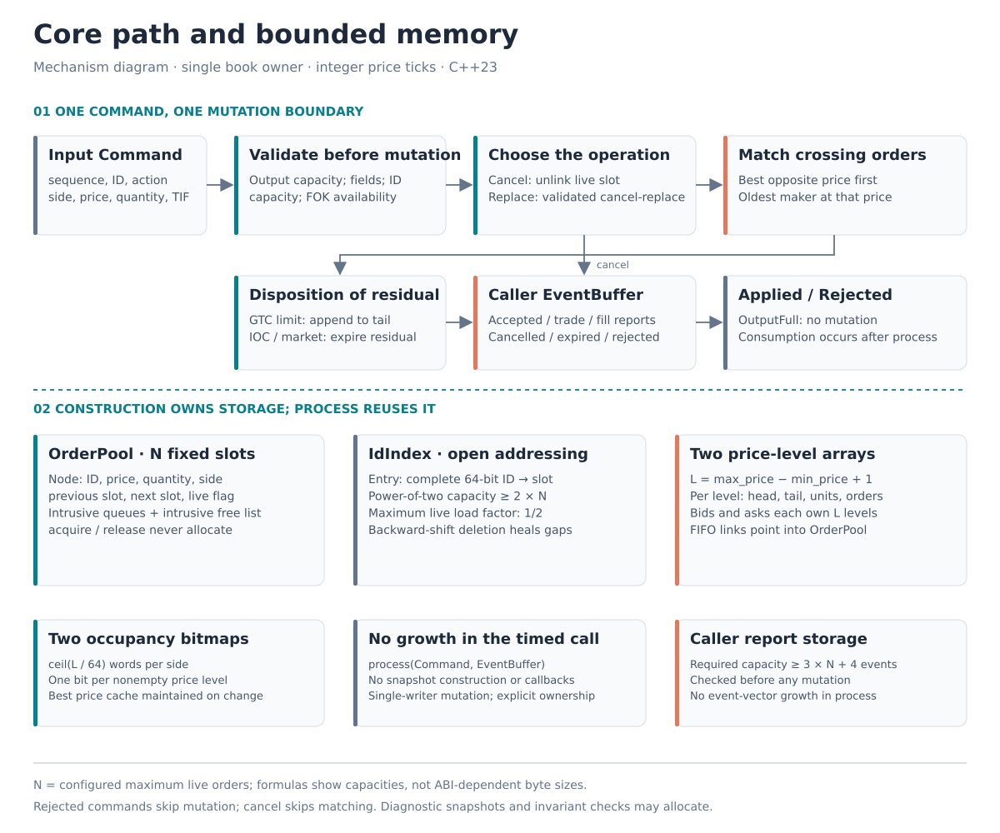

An optional SPSC adapter passes commands from one feed thread to one matching
thread. The matching core itself stays single-threaded and deterministic.

Additional components include a validated span-backed [feed view](docs/feed-format.md)
with no command-vector allocation and an optional integer [pre-trade risk
policy](docs/risk.md). The policy checks quantity, price, notional and projected
position; callers own pending-order reservations and invoke it explicitly.

| Component | Implementation | Cost / boundary |
|---|---|---|
| Prices | Positive `int64_t` ticks | Exact comparisons; configured range |
| Levels | Flat arrays + cached best quotes | O(1) known-price access |
| FIFO | Intrusive doubly linked slot indices | O(1) append/unlink |
| IDs | Preallocated open addressing; backward-shift erase | Expected O(1); bounded worst case |
| Orders | Fixed arena and free list | No heap requests while processing |
| Best search | Occupancy bitmap | Skips 64 empty prices per word |
| FOK preflight | Occupied-level bitmap traversal | Skips empty prices; preserves rejection atomicity |
| Reports | Caller-owned fixed buffer | Capacity checked before mutation |
| Reference | Maps, lists and ID hash map | Independent readable oracle |

Cancelling the last order at the best level also incurs price search. Matching
cost grows with executed makers. Full complexities and trade-offs are in
[design.md](docs/design.md); exact order/event rules are in
[semantics.md](docs/semantics.md). This worked trade distinguishes executed
makers from emptied price levels, two different drivers in the study:

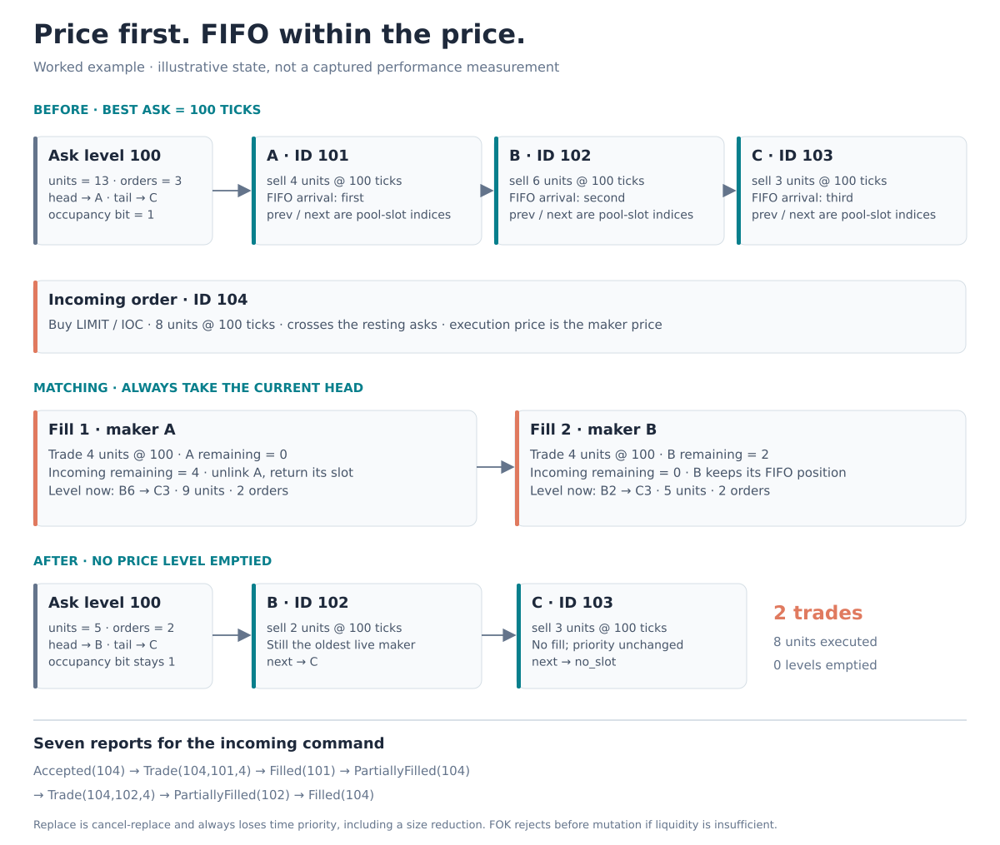

## Recorded performance

One million identical commands, seed `20261011`, five repetitions, separate
throughput and latency passes. GCC 13.3, C++23, `-O3 -DNDEBUG -march=native`, CPU 0
affinity, AMD EPYC 9V74 virtual host. Medians of run measurements:

| Engine | Commands/s | p50 | p99 | p99.9 |
|---|---:|---:|---:|---:|
| STL reference | 8.25M | 100 ns | 481 ns | 681 ns |
| Fast cached-linear | 18.67M | 50 ns | 301 ns | 410 ns |
| Fast bitmap | **18.74M** | **50 ns** | **271 ns** | **371 ns** |

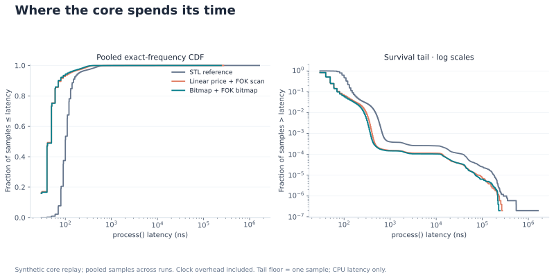

The stream contains 599,490 limits, 299,747 cancels and 100,763 markets;
**zero rejected commands**, 397,155 trades and peak 2,099 live orders. Batch
throughput includes execution-report checksumming. Latency times `process()`
only and includes clock overhead (median empty clock pair: 20 ns). Scheduler
outliers reach milliseconds; inspect maxima in the raw results. Bitmap search
reduces median p99 by 10% against cached-linear on this workload. Their throughput
difference is only 0.35%; this replay does not establish a meaningful throughput
advantage between the two fast modes.

Fresh [summary](bench/results/core-v2/summary.json), [runs](bench/results/core-v2/runs.csv)
and [exact latency frequencies](bench/results/core-v2/latency_histogram.csv) are
committed. The [initial evidence](docs/results.md) remains available separately.

## Performance across workloads

The original replay has no replacements or rejections. Six new
[traffic profiles](docs/workloads.md) exercise those paths, trade sweeps, and
sparse liquidity. Each overview profile uses three actual workload seeds and
three rotated-order runs per seed, with 100,000 commands per run, depth 256 per
side and a 20,000-tick domain. Error bars show observed min/max runs.

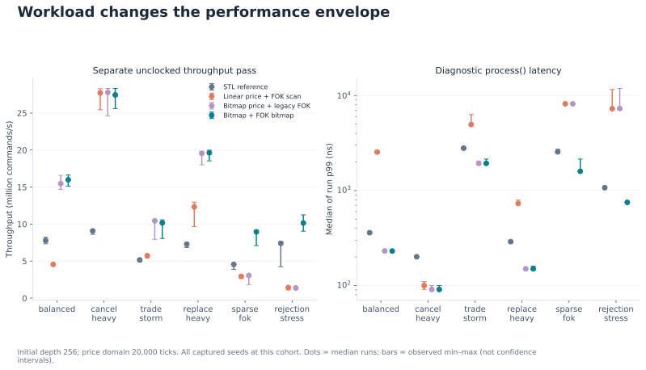

The bitmap engine ranges from **8.96M commands/s** in sparse FOK traffic to
**27.44M commands/s** in cancellation traffic. Trade bursts raise diagnostic
p99 to **1.93 µs**: one incoming order may execute many makers. The measured
mix makes these results interpretable:

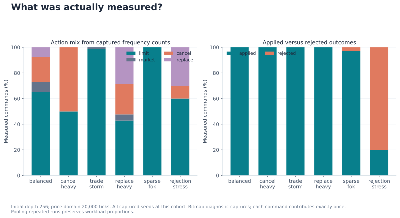

Study latency is measured in a separate diagnostic pass. An independent observer
reconstructs fills and emptied levels after each timed call; its accesses can
affect the next call's caches. These tails are distinct from the core replay.
Low-count conditional cells are masked, rather than treated as stable tails.

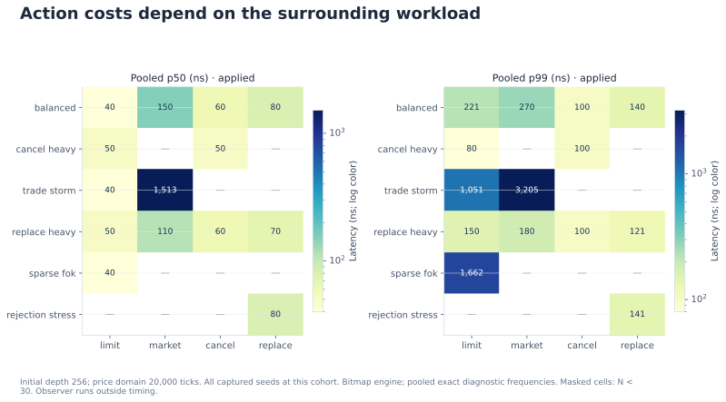

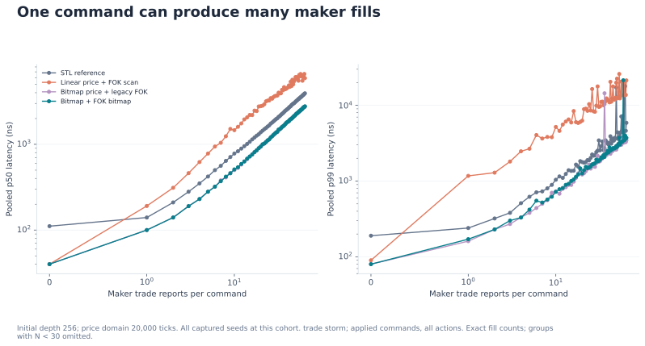

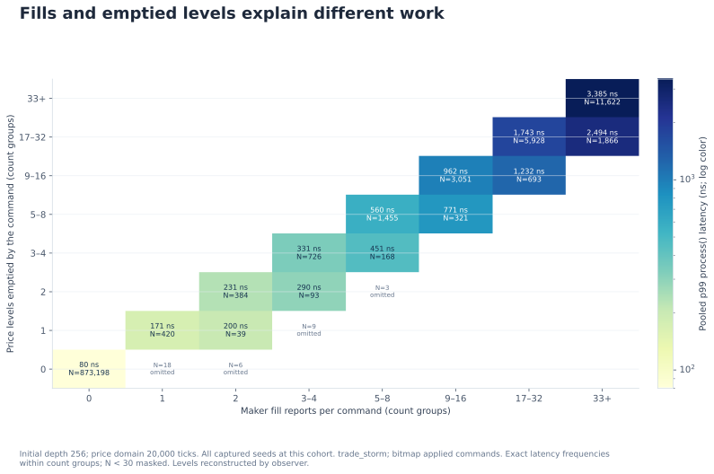

## A measured optimization and its limits

FOK previously scanned every eligible price tick during liquidity preflight,
even when the matching path used bitmap search. It now traverses occupied levels
using the same occupancy bits. The control `fast-fok-linear` retains bitmap price
search and the old FOK preflight, isolating this change.

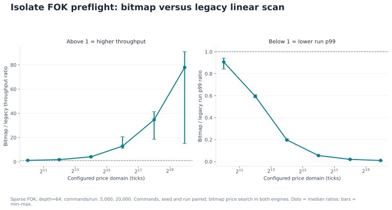

At depth 64 and a one-million-tick domain, bitmap FOK preflight improves whole
workload throughput by a **77.92x median paired ratio** over that legacy control.
This is a sparse synthetic stress result, not a universal speedup. The STL
reference reaches **5.50M commands/s** there, ahead of bitmap's **4.38M**: flat
arrays and bitmap-word traversal still depend on the configured price range.

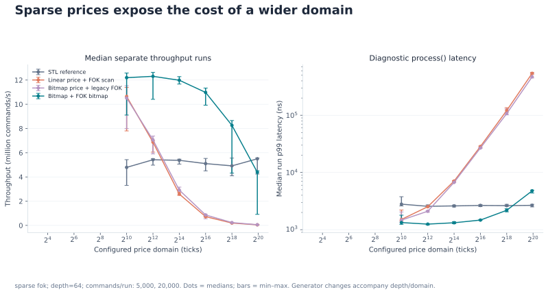

The [depth experiment](docs/figures/study/07-depth-scaling.svg) separately holds
the domain at 65,536 ticks and scales initial depth from 64 to 16,384 orders per
side. Generation changes with depth/domain; these experiments describe full
replays rather than isolated cache or asymptotic complexity measurements.

## Book state, handoff, and strategy accounting

Initial, midpoint, and final reference-book snapshots connect the workload to
the price-level distribution. A separate untimed trajectory records quotes,
live orders, resting quantity, and cumulative trades.

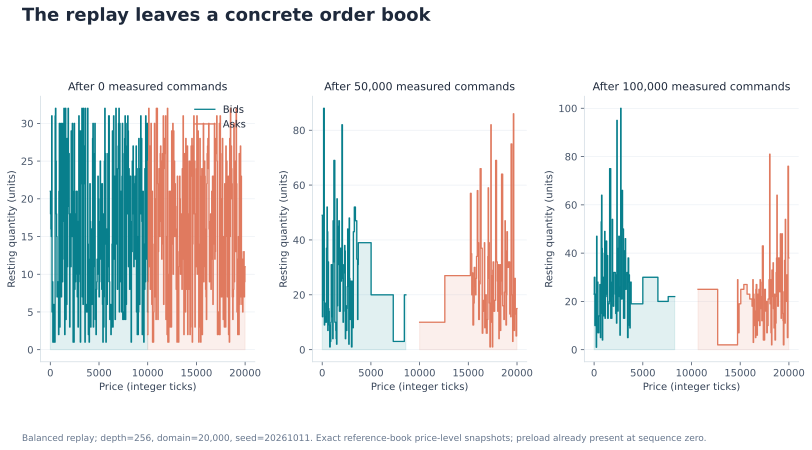

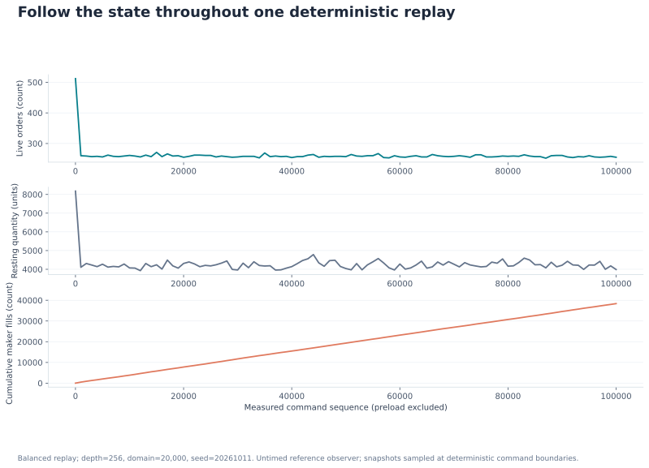

The SPSC study adds four queue capacities, two bounded arithmetic service costs,
three repetitions and separate zero-sample throughput / timestamped latency
runs: **48 captures, 48M transferred commands and 240,000 latency samples**.
Both worker affinities are verified on CPUs 1 and 2. Handoff latency includes
producer retry time, queue residence, consumer scheduling and core processing.

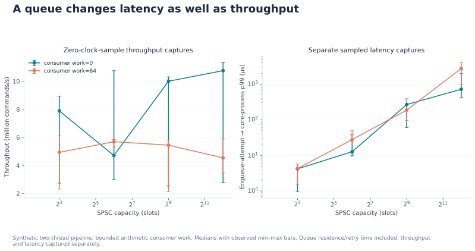

[Backpressure counters](docs/figures/study/15-queue-backpressure.svg) show retry
attempts per command; they measure neither drops nor occupancy. See
[telemetry.md](docs/telemetry.md) for exact timing boundaries and checksum checks.

## Correctness

- **74 named semantic tests** across both independently implemented engines.
- **100 seeds x 1M commands, rerun after the optimization:** 209,631,029 reports
  and 34,195,803 trades compared; bitmap, full linear and legacy FOK control
  agree with the reference. [Machine-readable result](bench/results/differential-v2.json).
- Per-command report/state/conservation/quote checks; **24,500** full structural
  and FIFO snapshot checkpoints.
- **1,000,140** fast-path calls with zero observed C++ heap allocations.
- GCC native and Clang ASan/UBSan CTest pass; a separate four-engine 1M-command
  sanitizer differential run passes. Local LeakSanitizer was disabled because the sandbox
  prevents its process inspection.
- Header/record parser fuzzing under libFuzzer, ASan and UBSan; seeded and
  unseeded campaigns complete without a finding.
- SPSC full/empty/wrap tests and 1M exact transfers pass under ThreadSanitizer.
- Dedicated [pool/index suites](docs/memory.md) cover collision-cluster deletion,
  wrapped probing, exhaustive slot recycling and long-running ownership churn.
- Feed-view tests cover hostile full-feed framing, unaligned golden bytes and
  1,000 allocation-free parse/access cycles. Risk tests cross-check 67,524
  assertions against independent integer arithmetic.
- Offline [evidence checks](docs/study-methodology.md) reconcile every diagnostic
  histogram with operation/fill/level counts, verify final conservation, and
  independently reconstruct plotted numbers and source hashes.

```sh
build/release/ledger_differential --seeds 100 --orders 1000000
cmake --preset asan && cmake --build --preset asan --parallel && ctest --preset asan
cmake --preset tsan && cmake --build --preset tsan --target ledger_spsc_tests
build/tsan/ledger_spsc_tests
cmake --preset fuzz && cmake --build --preset fuzz
mkdir -p build/corpus
build/fuzz/ledger_parser_fuzz build/corpus -max_total_time=30
```

The `fuzz` preset requires Clang. [GitHub Actions](https://github.com/michaelbawuah/Ledger-/actions)
checks GCC/Clang, ASan/UBSan, parser fuzzing, TSan, macOS/Windows builds, and
reproduces and audits the study figures from committed raw evidence.

## Synthetic market making

The toy strategy posts passive quotes, caps inventory, and accounts for cash
and P&L from actual execution reports. The default seed reports **-17,386
tick-units P&L** and maximum absolute inventory **20 units**; this is a synthetic
adverse-selection scenario with no fees or historical calibration. See
[strategy.md](docs/strategy.md) for fill-rate definitions and assumptions.

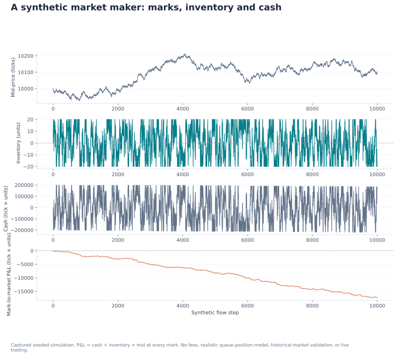

The 10,001-row [trace](bench/results/strategy-study/trace.csv) satisfies
`P&L = cash + inventory × mark` at every step and matches the final JSON.
No profitable seed was selected for the presentation.

## Reproduce the complete study

```sh
cmake --preset native && cmake --build --preset native --parallel
python3 tools/run_study.py --cpu 0
python3 tools/run_telemetry_study.py --producer-cpu 1 --consumer-cpu 2
taskset -c 0 build/native/ledger_bench --commands 1000000 --seed 20261011 --runs 5 --outdir bench/results/core-v2
python3 -m pip install matplotlib==3.10.8
python3 tools/plot_study.py --study-root bench/results/study --core-root bench/results/core-v2 --strategy-trace bench/results/strategy-study/trace.csv --spsc-root bench/results/spsc-study --outdir docs/figures/study
python3 tools/draw_architecture.py --outdir docs/figures/study
python3 tools/verify_study.py --study-root bench/results/study --plot-manifest docs/figures/study/plot-manifest.json
```

Choose allowed CPUs on your host; omit the Linux affinity flags for portable
runs. `--smoke` produces a small verification matrix; `--resume` reuses only
cells that pass the independent audit. For fast offline review, inspect the
[audit report](bench/results/study-audit.json),
[source provenance](bench/results/study-build-provenance.json), and
[figure manifest](docs/figures/study/plot-manifest.json).

## Scope and references

Single bounded instrument, offline replay and an optional feed-thread adapter.
Stop orders, ITCH ingestion, multi-instrument routing, UDP publication, Python
bindings, durable recovery and exchange sessions are future work.

The implementation is original; the two supplied projects informed the design:
[brprojects/Limit-Order-Book](https://github.com/brprojects/Limit-Order-Book) and
[jxm35/LimitOrderBook-MatchingEngine](https://github.com/jxm35/LimitOrderBook-MatchingEngine).
Attribution and measurement boundaries: [references.md](docs/references.md).

[MIT license](LICENSE) · Michael Baffour Awuah
