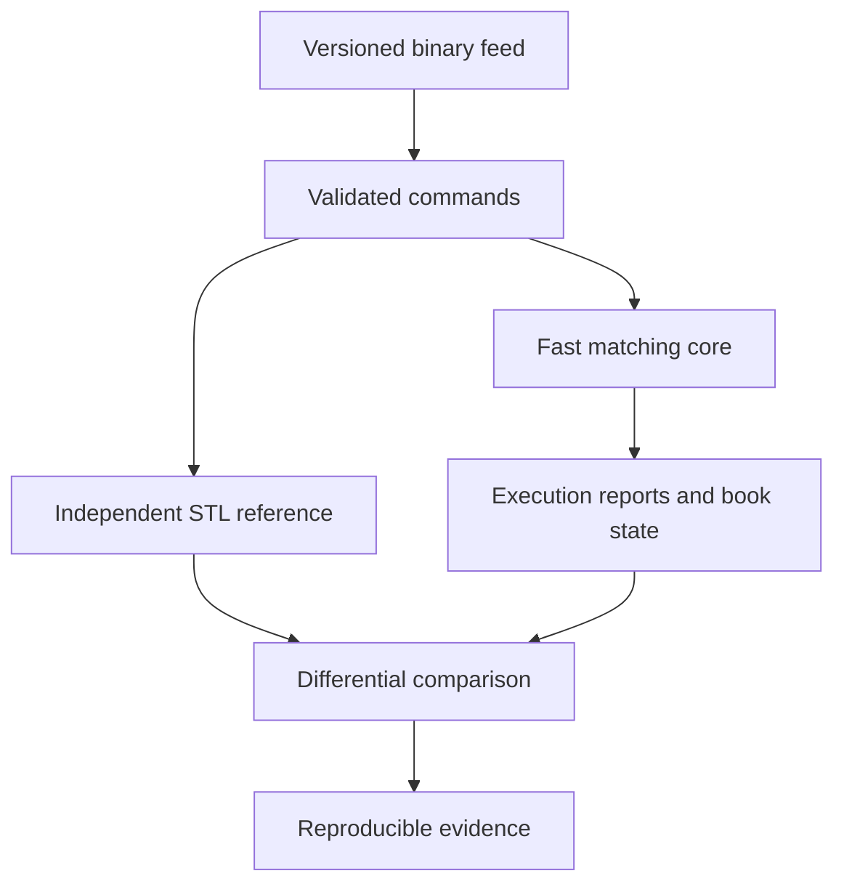
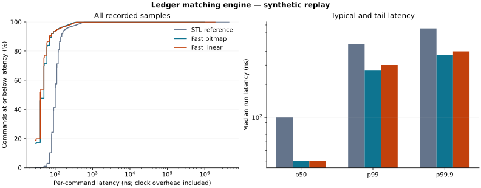

# Ledger

**An allocation-free C++23 limit order book and matching engine, verified against an independent reference engine.**

On the recorded synthetic replay: **19.24M commands/s**, **271 ns p99**, and
**2.19x reference throughput**. Correctness: **100 million differential commands**
with identical reports and state checks. These are matching-core measurements on
an AMD EPYC virtual host, not live-exchange or network latency.

## Build and run

Requires a C++23 compiler, CMake 3.21+ and Ninja. GoogleTest is used when installed;
the identical named semantic cases also run through a dependency-free harness.

```sh
cmake --preset release
cmake --build --preset release --parallel
ctest --preset release
```

Replay, benchmark and strategy examples:

```sh
build/release/ledger_generate --out orders.lob --commands 1000000 --seed 20261011
build/release/ledger_replay --input orders.lob --engine fast-bitmap --events executions.csv
build/release/ledger_bench --input orders.lob --runs 5 --outdir bench/results/local
build/release/ledger_market_maker --steps 10000 --seed 42
build/release/ledger_spsc_bench --commands 1000000 --latency-samples 10000
```

See [results.md](docs/results.md) for the exact native build, affinity and
reproduction commands used for the headline numbers. CPU-dependent numbers will
vary. `release` is portable; `native` adds `-march=native` for the local host.

## Order flow

Limit and market orders, cancel-replace, partial fills, GTC/IOC/FOK, arbitrary
64-bit IDs and integer tick prices. Matching follows best price, then FIFO;
trades execute at the resting maker's price. Rejected replacements preserve the
original order. Full buffers fail before book mutation. Execution reports cover
acceptance, trades, partial/full fills, cancellation, expiry and rejection.



An optional SPSC adapter passes commands from one feed thread to one matching
thread. The matching core itself stays single-threaded and deterministic.

| Component | Implementation | Cost / boundary |
|---|---|---|
| Prices | Positive `int64_t` ticks | Exact comparisons; configured range |
| Levels | Flat arrays + cached best quotes | O(1) known-price access |
| FIFO | Intrusive doubly linked slot indices | O(1) append/unlink |
| IDs | Preallocated open addressing; backward-shift erase | Expected O(1); bounded worst case |
| Orders | Fixed arena and free list | No heap requests while processing |
| Best search | Occupancy bitmap | Skips 64 empty prices per word |
| Reports | Caller-owned fixed buffer | Capacity checked before mutation |
| Reference | Maps, lists and ID hash map | Independent readable oracle |

Cancelling the last order at the best level also incurs price search. Matching
cost grows with executed makers. Full complexities and trade-offs are in
[design.md](docs/design.md); exact order/event rules are in
[semantics.md](docs/semantics.md).

## Recorded performance

One million identical commands, seed `20261011`, five repetitions, separate
throughput and latency passes. GCC 13.3, C++23, `-O3 -DNDEBUG -march=native`, CPU 0
affinity, AMD EPYC 9V74 virtual host. Medians of run measurements:

| Engine | Commands/s | p50 | p99 | p99.9 |
|---|---:|---:|---:|---:|
| STL reference | 8.79M | 100 ns | 471 ns | 651 ns |
| Fast cached-linear | 18.86M | 40 ns | 301 ns | 401 ns |
| Fast bitmap | **19.24M** | **40 ns** | **271 ns** | **371 ns** |



The stream contains 599,490 limits, 299,747 cancels and 100,763 markets;
**zero rejected commands**, 397,155 trades and peak 2,099 live orders. Batch
throughput includes execution-report checksumming. Latency times `process()`
only and includes clock overhead (median empty clock pair: 20 ns). Scheduler
outliers reach milliseconds; inspect maxima in the raw results. The bitmap
change reduces median p99 by 10% against cached-linear on this workload;
the 2% throughput difference is small and sensitive to host noise.

Raw [summary](bench/results/core/summary.json), [runs](bench/results/core/runs.csv)
and [exact latency frequencies](bench/results/core/latency_histogram.csv) are
committed. [results.md](docs/results.md) records measurement limits and profiling.

## Correctness

- **74 named semantic tests** across both independently implemented engines.
- **100 seeds x 1M commands:** 209,631,029 reports and 34,195,803 trades compared;
  bitmap and cached-linear agree with the reference.
- Per-command report/state/conservation/quote checks; **24,500** full structural
  and FIFO snapshot checkpoints.
- **1,000,140** fast-path calls with zero observed C++ heap allocations.
- GCC release and Clang ASan/UBSan CTest pass; a separate 1M-command sanitizer
  differential run passes. Local LeakSanitizer was disabled because the sandbox
  prevents its process inspection.
- Header/record parser fuzzing under libFuzzer, ASan and UBSan; seeded and
  unseeded campaigns complete without a finding.
- SPSC full/empty/wrap tests and 1M exact transfers pass under ThreadSanitizer.

```sh
build/release/ledger_differential --seeds 100 --orders 1000000
cmake --preset asan && cmake --build --preset asan --parallel && ctest --preset asan
cmake --preset tsan && cmake --build --preset tsan --target ledger_spsc_tests
build/tsan/ledger_spsc_tests
cmake --preset fuzz && cmake --build --preset fuzz
mkdir -p build/corpus
build/fuzz/ledger_parser_fuzz build/corpus -max_total_time=30
```

The `fuzz` preset requires Clang. GitHub Actions is configured for GCC/Clang,
ASan/UBSan, parser fuzzing, TSan, and macOS/Windows builds. Remote CI results
depend on publishing this repository and are not asserted by the local evidence.

## Synthetic market making

The toy strategy posts passive quotes, caps inventory, and accounts for cash
and P&L from actual execution reports. The default seed reports **-17,386
tick-units P&L** and maximum absolute inventory **20 units**; this is a synthetic
adverse-selection scenario with no fees or historical calibration. See
[strategy.md](docs/strategy.md) for fill-rate definitions and assumptions.

## Scope and references

Single bounded instrument, offline replay and an optional feed-thread adapter.
Stop orders, ITCH ingestion, multi-instrument routing, UDP publication, Python
bindings, durable recovery and exchange sessions are future work.

The implementation is original; the two supplied projects informed the design:
[brprojects/Limit-Order-Book](https://github.com/brprojects/Limit-Order-Book) and
[jxm35/LimitOrderBook-MatchingEngine](https://github.com/jxm35/LimitOrderBook-MatchingEngine).
Attribution and measurement boundaries: [references.md](docs/references.md).

[MIT license](LICENSE) · Michael Baffour Awuah
