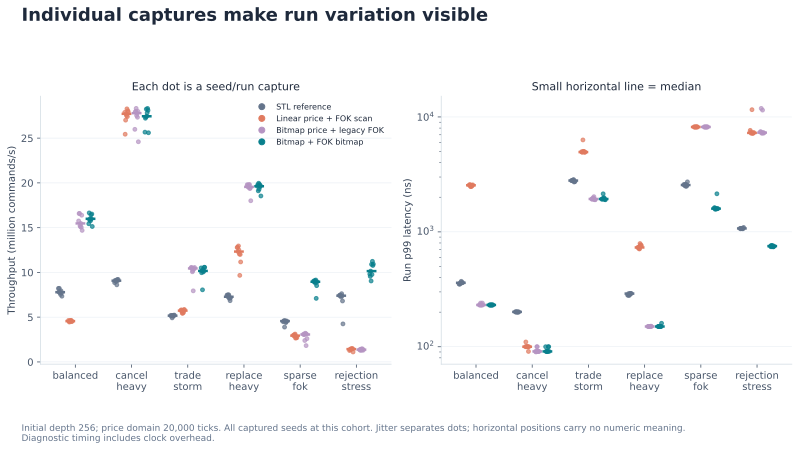
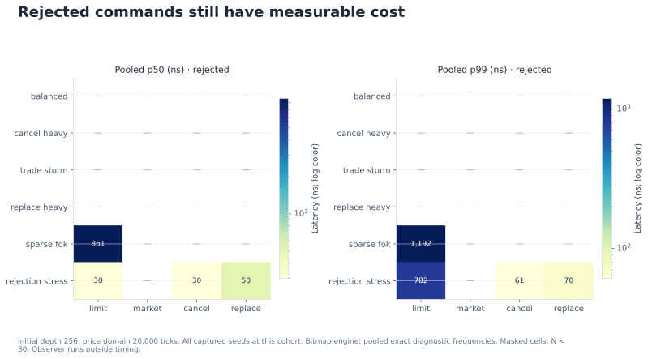
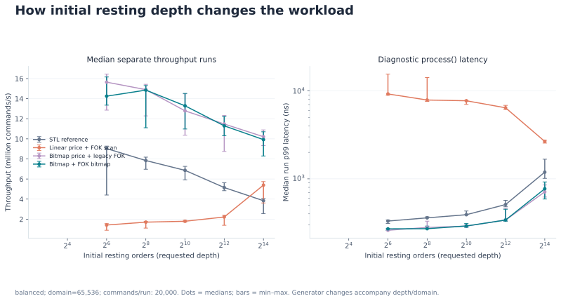
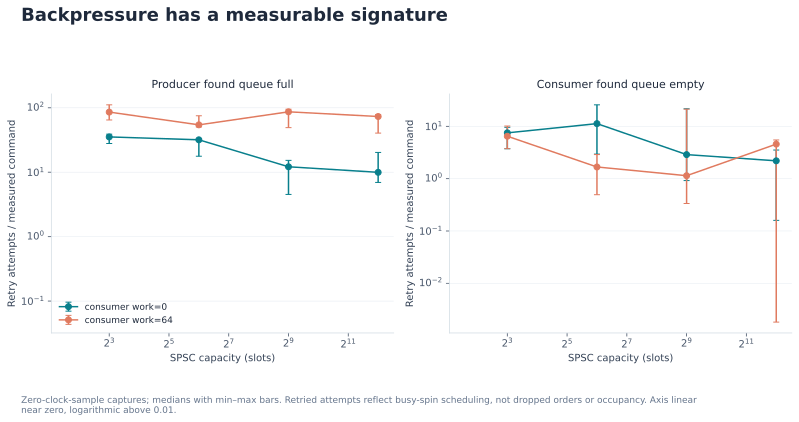

# Ledger: a measured performance envelope

Ledger's bitmap engine reaches **18.74 million commands/s and 271 ns median run
p99** in the refreshed core replay, with **2.27× reference throughput** on the
same host. A broader study shows where that result holds and where it does not:
command mix, maker fills, initial depth, and price sparsity change the envelope.
At the widest sparse domain, the ordered reference engine outperforms the bitmap
engine. The retained evidence includes that unfavorable result.

The study contains **51 experiment cells, 612 engine/run combinations, and
28,440,000 exact diagnostic latency observations**. These are captured synthetic
replays, not live exchange measurements. All headline throughput measurements
use separate whole-batch passes; conditional latency figures use a separate
observer pass. The [methodology](study-methodology.md) defines these boundaries.

## Evidence and protocol

The capture host was Linux 6.18.44 x86-64 on an AMD EPYC 9V74; the environment
reported nine available hardware threads. GCC 13.3.0 compiled C++23 with `-O3
-DNDEBUG -march=native`. Core and workload studies used affinity CPU 0; the queue
producer and consumer were pinned to CPUs 1 and 2. This was a shared execution
environment, not a controlled bare-metal laboratory. The steady-clock pair
median was 20 ns; clock overhead remains in latency samples.

| Experiment | Parameters | Retained observations |
| --- | --- | --- |
| Core replay | 1,000,000 commands; seed 20261011; five repeats; three engines; 50,000-command warmup | 15 engine runs; 15,000,000 latency samples |
| Workload overview | Six profiles; depth 256 per side; domain 20,000; 100,000 commands | 18 cells; 216 engine runs; 21,600,000 diagnostic samples |
| Depth sweep | Balanced; domain 65,536; depths 64, 256, 1,024, 4,096, 16,384 per side; 20,000 commands | 15 cells; 180 engine runs; 3,600,000 diagnostic samples |
| Domain sweep | Sparse FOK; depth 64 per side; six domains; 20,000 commands up to 65,536 ticks, 5,000 above | 18 cells; 216 engine runs; 3,240,000 diagnostic samples |
| SPSC pipeline | Capacities 8, 64, 512, 4,096; consumer work 0 or 64; separate zero-clock and 10,000-sample passes; three repeats | 48 captures; 48,000,000 commands; 240,000 timestamp samples |
| Strategy trace | Seed 42; 10,000 flow steps; quote quantity five; inventory limit 20 units | 10,001 accounting rows including initial state |

Every workload cell uses seeds 20261011, 20261012, or 20261013, three repeats,
and four engines: reference, full linear search, bitmap search, and bitmap search
with legacy linear FOK preflight. Thus each profile/configuration has nine runs
per engine. The study's 2,370,000 commands across 51 distinct streams are replayed
across engines and repeats; throughput passes, warmup, and preload are additional
execution work and are not extra latency observations.

Fresh books receive identical untimed preload. Warmup uses another fresh book
before each pass; overview warmup is 10,000 commands. Engine order rotates by
repeat. Every selected engine must agree with the reference on execution reports
and complete final snapshots. Exact bins preserve every captured sample rather
than a selected best percentile.

Capture date is 2026-10-12 UTC. [Build provenance](../bench/results/study-build-provenance.json)
records source blob hashes and CPU assignments. Two incomplete cells were
repeated in full after `runs.csv` and `timeline.csv` were found empty. All retained
files for those cells came from fresh serial captures; no performance threshold
selected the replacement.

Raw packets are preserved in [core-v2](../bench/results/core-v2/summary.json),
[overview](../bench/results/study/overview), [depth](../bench/results/study/depth),
[domain](../bench/results/study/domain), [queue captures](../bench/results/spsc-study/capture-metadata.json),
and [strategy summary](../bench/results/strategy-study/summary.json). The
[figure manifest](figures/study/plot-manifest.json) maps quantitative series to
hashed source files and records their filters and plotted values.

## Core replay and workload envelope

The refreshed core replay records bitmap medians of 18.737939 million commands/s,
50 ns p50, 271 ns p99, and 371 ns p99.9. Reference throughput is 8.250569 million
commands/s with 481 ns p99. Linear search reaches 18.671948 million commands/s
with 301 ns p99. This relatively small bitmap/linear throughput difference is
specific to this core replay; it does not describe the sparse-workload cases.


The overview below reports the median of nine **per-run** metrics for each
engine. Latency is diagnostic `process()` time; p99.9 is not a maximum. Throughput
ranges are observed minimum–maximum runs, not confidence intervals.

| Profile | Bitmap throughput, million commands/s | Observed throughput range | Bitmap p50, ns | Bitmap p99, ns | Bitmap p99.9, ns | Reference throughput, million commands/s |
| --- | ---: | ---: | ---: | ---: | ---: | ---: |
| Balanced | 15.987 | 15.130–16.650 | 50 | 231 | 290 | 7.788 |
| Cancel heavy | 27.442 | 25.601–28.314 | 50 | 91 | 170 | 9.075 |
| Trade storm | 10.169 | 8.055–10.577 | 40 | 1,933 | 2,744 | 5.163 |
| Replace heavy | 19.626 | 18.538–19.964 | 60 | 150 | 200 | 7.280 |
| Sparse FOK | 8.956 | 7.100–9.152 | 40 | 1,592 | 2,333 | 4.559 |
| Rejection stress | 10.145 | 9.043–11.238 | 40 | 751 | 951 | 7.398 |


Profile labels alone do not reveal the actual work. Trade-storm input contains
98.511% limit commands and 1.489% markets: many replenishments precede each maker
sweep. Its low median and much larger p99 therefore describe different command
populations. Rejection stress rejects 80.046% of commands, while sparse FOK rejects
2.992%. The figures below expose the measured mix and each individual run.




## Explain the tail with observed work

Unconditional percentiles can obscure which operations cost time. The action
figures separate applied and rejected commands, with pooled exact frequencies
at the overview cohort. Groups below 30 observations are masked. The observer
runs outside the timed call but can change the cache state of later commands;
these conditional results are explanatory measurements rather than the core
headline benchmark.




For bitmap trade-storm commands, the pooled applied zero-fill group contains
873,198 observations and has p99 80 ns. The exact 64-maker-fill group contains
363 observations and has p99 3,726 ns. This is a useful distinction: matching one
incoming order can emit many maker fills, while each emptied price level may
contain more than one order. Neither count is an inferred internal scan count.


## Depth and price sparsity

Holding the balanced domain at 65,536 ticks, increasing initial depth per side
changes bitmap throughput and tails as shown below. Depth also changes preload,
capacity, and generated interactions, so the sweep does not isolate one cache
or allocator mechanism.

| Initial orders per side | Bitmap throughput, million commands/s | Median run p99, ns | Median run p99.9, ns |
| ---: | ---: | ---: | ---: |
| 64 | 14.250 | 270 | 371 |
| 256 | 14.852 | 271 | 330 |
| 1,024 | 13.288 | 291 | 381 |
| 4,096 | 11.293 | 340 | 551 |
| 16,384 | 9.922 | 771 | 1,102 |



The sparse-domain sweep holds initial depth at 64 orders per side. Bitmap
throughput stays near 12 million commands/s through 16,384 ticks, then declines.
The widest domains use 5,000 commands per run to bound the legacy scan cost,
so their run duration and statistical support differ from the smaller cases.

| Domain, ticks | Commands/run | Bitmap throughput, million commands/s | Reference throughput, million commands/s | Bitmap p99, ns | Reference p99, ns |
| ---: | ---: | ---: | ---: | ---: | ---: |
| 1,024 | 20,000 | 12.197 | 4.790 | 1,332 | 2,794 |
| 4,096 | 20,000 | 12.306 | 5.419 | 1,252 | 2,564 |
| 16,384 | 20,000 | 11.983 | 5.372 | 1,322 | 2,604 |
| 65,536 | 20,000 | 10.978 | 5.102 | 1,473 | 2,654 |
| 262,144 | 5,000 | 8.260 | 4.915 | 2,184 | 2,634 |
| 1,000,000 | 5,000 | 4.382 | 5.498 | 4,778 | 2,664 |


At 1,000,000 ticks the reference is faster and has a lower p99. A larger fixed
price-domain representation is therefore not automatically the best choice
for sparse liquidity. The result identifies a case for future representation
work; this packet does not establish the cause through hardware counters.

## Controlled FOK preflight comparison

Both compared engines use bitmap next-price lookup and the same storage. Only
FOK preflight differs. Each ratio pairs the same seed and run, then reports the
median of those nine ratios. This differs from dividing two separately computed
median throughputs.

| Sparse domain, ticks | Median bitmap/legacy throughput ratio | Observed ratio range | Median legacy/bitmap p99 ratio |
| ---: | ---: | ---: | ---: |
| 1,024 | 1.115× | 0.877–1.289× | 1.104× |
| 4,096 | 1.744× | 1.411–2.140× | 1.685× |
| 16,384 | 4.066× | 3.742–4.256× | 5.083× |
| 65,536 | 12.853× | 11.135–20.544× | 18.160× |
| 262,144 | 34.708× | 18.617–41.324× | 49.003× |
| 1,000,000 | 77.924× | 15.083–90.910× | 99.112× |

The figure displays bitmap/legacy p99 instead, so its latency ratio decreases
when bitmap wins. One small-domain throughput pair is below one. The large
wide-domain improvement is against the deliberately retained linear FOK
control, not a claim of universal improvement or superiority to another repo.


## The book state behind the measurements

Reference-book snapshots show actual resting quantities at initial, midpoint,
and final sequences. The trajectory records live orders, resting quantity,
best prices, and cumulative trade count at deterministic boundaries. These
untimed captures help distinguish trading work from a benchmark that merely
accepts and cancels orders.


## Queue capacity changes the latency boundary

The SPSC study uses a synthetic five-command lifecycle with one million commands,
2.2 million events, and 400,000 trades per capture. Every capture produces and
consumes the full command count. Throughput comes from zero-sample runs; latency
comes from separate runs with 10,000 samples. Each listed value is the median of
three repetitions. Sampled latency starts at the first enqueue attempt and ends
after core processing, including retry waiting and residence in the queue.

| Queue capacity | Consumer work | Zero-sample throughput, million commands/s | Separate sampled p99, µs |
| ---: | ---: | ---: | ---: |
| 8 | 0 | 7.883 | 4.186 |
| 64 | 0 | 4.709 | 12.644 |
| 512 | 0 | 10.004 | 267.372 |
| 4,096 | 0 | 10.760 | 718.116 |
| 8 | 64 | 4.933 | 4.261 |
| 64 | 64 | 5.689 | 27.677 |
| 512 | 64 | 5.445 | 186.787 |
| 4,096 | 64 | 4.537 | 2,748.463 |


Throughput is not monotonic with capacity, and sampled-pass throughput is not
used as the headline. Large buffers can support substantially longer observed
end-to-end latency; with 64 arithmetic work rounds, the 4,096-slot median p99 is
2.748 ms. This is a pipeline/scheduling measurement, not a nanosecond matching
claim. Full/empty retry counts represent busy-spin attempts, not dropped orders
or measured occupancy.



## Strategy accounting includes an unfavorable outcome

The seeded passive market-maker simulation finishes with **−17,386 tick-units
of mark-to-market P&L**. Inventory ends at −20 units and never exceeds the
configured 20-unit absolute limit. Cash ends at 184,694 tick-units, with final
mid 10,104 ticks: `184694 + (-20 * 10104) = -17386`. The trace contains 36,070
maker-filled units across 9,294 maker trade events; quoted-unit fill rate is
40.024%, distinct from the 92.940% flow-order maker-fill rate.


Every row satisfies `P&L = cash + inventory * mid`, and its final values agree
with the summary. This is execution/accounting validation, not profitable live
trading. Fees, exchange queue position, historical-market validation, and live
orders are absent from the simulation and explicitly disclosed in the source.

## Reproduce and audit the retained packet

```sh
cmake --preset native
cmake --build --preset native --parallel
taskset -c 0 build/native/ledger_bench --commands 1000000 --seed 20261011 --runs 5 --warmup 50000 --outdir bench/results/core-local
python3 tools/run_study.py --binary-dir build/native --cpu 0 --outdir bench/results/study-local
python3 tools/run_telemetry_study.py --binary-dir build/native --producer-cpu 1 --consumer-cpu 2 --queue-outdir bench/results/queue-local --strategy-outdir bench/results/strategy-local
python3 tools/plot_study.py --study-root bench/results/study-local --core-root bench/results/core-local --spsc-root bench/results/queue-local --strategy-trace bench/results/strategy-local/trace.csv --outdir docs/figures/local
python3 tools/verify_results.py bench/results/core-local
python3 tools/verify_study.py --study-root bench/results/study-local --plot-manifest docs/figures/local/plot-manifest.json
```

Choose allowed CPU indices on your host. Preserve the original packet and write
new-host results separately. The Python audit independently reconstructs
quantiles from integer cumulative counts, throughput from command/time arithmetic,
conditional marginals, weighted trade reports, final quantity conservation,
source hashes, plotted values, and the full strategy accounting trajectory.
Tests deliberately mutate these relationships to verify that contradictions fail.

The [memory contract](figures/study/17-core-memory-contract.svg) and
[FIFO worked trade](figures/study/18-fifo-worked-trade.svg) are explanatory diagrams.
They do not contain measurements. Internal consistency and provenance cannot
prove data collection, uniquely identify FIFO state from aggregates, or establish
performance on other machines. The complete source, semantic tests, and reference
comparison remain part of assessing these results.
